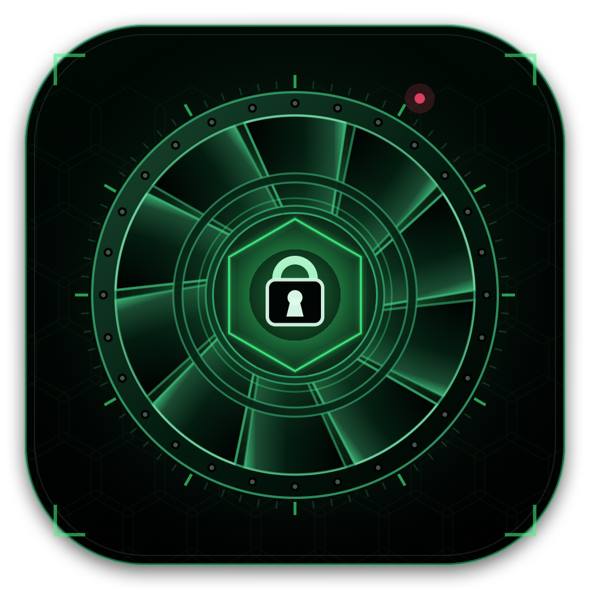
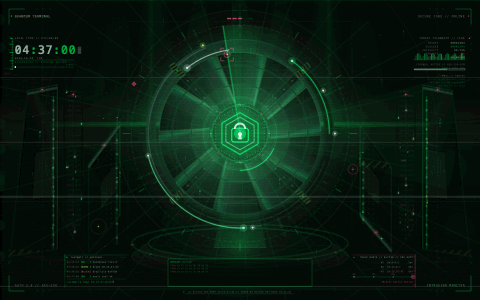

# Quantum Terminal Live

[](https://github.com/ZeroXSHDW/quantum-terminal-live/actions/workflows/ci.yml)
[](LICENSE)
[](https://github.com/ZeroXSHDW/quantum-terminal-live/releases)
[](https://buy.stripe.com/fZu4gA5KUdlP40deDr14403)



**A procedural 8K cyber-security vault for macOS** — a live desktop layer and a matching 30-second screen saver, drawn entirely in code.

The scene is built entirely in Swift and Core Graphics: a machined iris vault, a rotating threat radar, a shield-and-lock secure core, a glowing terminal clock, server pylons, a reflective operations floor, code-rain data walls and a live sentinel console. Threat telemetry, trace-route hops and a scrolling packet ticker run around the edges; every 15 seconds the vault drops into a red lockdown state. No stock artwork, no network calls, no telemetry.

## Live preview



_This is the exact 30-second loop shipped in [`Quantum-Terminal-Live-30s.mov`](Assets/Quantum-Terminal-Live-30s.mov), rendered frame-by-frame from the live scene — the GIF loops seamlessly, just like the screen saver. Watch the [full-resolution 8K loop](Assets/Quantum-Terminal-Live-30s.mov) or a [sharp static frame](docs/preview.jpg)._

## Highlights

- **7680 × 4800 procedural master** — the environment is generated by code, not shipped as opaque artwork.
- **Live terminal clock** — a neon chrono module shows your real local time on the desktop; the loop renders a deterministic reference clock.
- **Sentinel operations console** — a scrolling auth/block log, shell prompt with a blinking cursor, and a trace-route panel with a travelling probe.
- **Threat-response lockdown** — a DEFCON badge, red alert band, pylon strobes and warning arcs turn the vault hostile for 1.7 seconds every 15 seconds.
- **Live telemetry** — probe/block/integrity/threat/uptime counters, a sparkline, and an animated vault-seal progress bar.
- **Code rain and data walls** — glyph curtains and falling packets fill the service aisles without covering the vault.
- **Infinite Matrix depth** — a receding corridor of light converges on the core, backed by a faint full-screen digital-rain curtain, twinkling motes, two parallax dust fields, near-field bokeh, a slow volumetric light sweep and a far echo radar, so the vault reads as floating in an endless green void.
- **Memory dump and process table** — a recessed `MEMDUMP 0x7F3A` strip with continuously counting bytes, and a `PROC // SENTRY` task list under the telemetry.
- **Live CRT artifacts** — a periodic full-frame glitch, an activity-reactive rain that surges right after input, and a one-time boot fade-in.
- **Menu-bar control** — a status item pauses/resumes the layer, sets neon intensity (Vivid/Standard/Dim), toggles idle dimming, opens Aerial, reveals the app, or quits.
- **Power-aware** — drops to 10 fps on battery and 2 fps when fully covered or in Low Power Mode, and fades the desktop after five minutes of idle to protect OLED panels.
- **Procedural app icon** — the iris-and-lock emblem is drawn in code at every iconset size and bundled as `AppIcon.icns`.
- **Live desktop layer** — one borderless window per display at desktop level, **above the wallpaper and below Finder icons**, so icons and clicks keep working.
- **Always-on by design** — a 20 fps live overlay (the 30 s movie stays 30 fps), App Nap disabled, launchd `KeepAlive`, a watchdog that restores animation/windows after wake, lock, or display hot-plug, and automatic cadence throttling when covered, on battery, or in Low Power Mode.
- **30-second seamless 8K HEVC screen saver** — every motion term has an integer period over 30 s, so the loop has no visible seam.
- **Aerial 4.1 integration** — installs a dedicated *Quantum Terminal* user playlist containing only this loop.
- **Local-only** — no network endpoints, accounts, analytics, or external services.

## Get it — €5

Prefer the pre-built package? [Buy it for **€5**](https://buy.stripe.com/fZu4gA5KUdlP40deDr14403) and get the app bundle, the 8K loop, and lifetime updates delivered instantly (card / Apple Pay via Stripe):

1. Pay via Stripe (card / Apple Pay).
2. Download the `.app` and the `.mov` in one click.
3. Drag to install — done.

Buying supports the project; the source stays **MIT-licensed and free to build** with `./scripts/install.sh`. See [docs/SELLING.md](docs/SELLING.md) for how the storefront is wired up.

## Requirements

- Apple Silicon Mac (arm64)
- macOS 14 or later
- Xcode Command Line Tools (`xcode-select --install`)
- Optional: [Aerial](https://github.com/AerialScreensaver/Aerial) 4.1+ for the screen saver on macOS 26

## Quick start

```sh
git clone https://github.com/ZeroXSHDW/quantum-terminal-live.git quantum-terminal-live
cd quantum-terminal-live
./scripts/install.sh
```

That builds the app, installs it to `~/Applications`, registers a user LaunchAgent, and copies the 8K loop to `~/Movies/Quantum Terminal/`.

To also register the loop with Aerial:

```sh
./scripts/install.sh --with-aerial
```

Or use the Makefile:

```sh
make build       # compile binaries and assemble the .app
make validate    # repository hygiene checks
make icon        # regenerate Assets/AppIcon.icns
make install     # install app + LaunchAgent
make assets      # regenerate the 8K PNG and movie
```

## The screen saver

macOS 26 uses a single wallpaper-extension architecture for both the desktop and the idle screen. Aerial 4.1 provides that extension. `--with-aerial`:

1. Copies the movie into `/Users/Shared/Aerial/My Videos/`.
2. Waits for Aerial to index it.
3. Creates a user playlist named **Quantum Terminal** with exactly one 30-second entry.
4. Points the shared and per-screen playlists at that user playlist.
5. Backs up the previous `playlists.json` and forces the wallpaper extension to reload.

Aerial must be selected as the system **Wallpaper/Screen Saver** in System Settings → Wallpaper. The installer does not change that system setting silently.

If Aerial is not installed, the app and the movie in `~/Movies/Quantum Terminal/` still work; the screen saver can be enabled later.

## Build from source

```sh
./scripts/build.sh
```

Outputs:

```
build/Quantum Terminal Live.app
build/QuantumTerminalLive
build/QuantumLoopMaker
build/RenderArtwork
build/RenderFrame
build/IconMaker
```

The app bundle is ad-hoc signed, which is sufficient for a locally installed, non-notarized utility. It contains:

```
Contents/Info.plist
Contents/MacOS/QuantumTerminalLive
Contents/Resources/AppIcon.icns
Contents/Resources/quantum-terminal-live-wallpaper-8k.png
```

The icon is rendered from `Sources/IconMaker.swift` on every build. To refresh the
committed icon files only:

```sh
./scripts/make-icon.sh   # Assets/AppIcon.icns + Assets/AppIcon-1024.png
```

## Regenerate the artwork and movie

```sh
./scripts/make-assets.sh            # full 8K PNG + 30 s movie
./scripts/make-assets.sh --preview  # fast 1920 × 1200 previews
```

The movie is encoded at 22 Mbps specifically so it stays below GitHub's 100 MB per-file limit (the included file is ~80 MB). It is already tracked with **Git LFS** (`*.mov filter=lfs` in [.gitattributes](.gitattributes)); if you raise the bitrate, publish the movie as a GitHub Release asset as well.

Rendering the full 8K movie takes roughly 12 minutes on an M-series Mac and writes ~80 MB.

## How it works

| File | Role |
| --- | --- |
| `Sources/QuantumArtwork.swift` | Static 8K environment: sky, ceiling grid, data columns, aisle data walls, floor circuitry, server pylons, platform, iris vault. |
| `Sources/QuantumScene.swift` | Shared animated layer: radar, energy rings, shield/lock core, chrono clock, threat telemetry, sentinel console, trace route, code rain, ticker, alerts, traffic, particles, HUD. |
| `Sources/QuantumTerminalLive.swift` | Accessory app; per-display desktop windows, composited static master + 20 fps overlay, real wall-clock time, watchdog, App Nap suppression. |
| `Sources/QuantumLoopMaker.swift` | Renders the 30 s loop into 8K HEVC with AVAssetWriter. |
| `Sources/RenderArtwork.swift` | CLI that writes the master PNG at any resolution. |
| `Sources/IconMaker.swift` | Renders the vault emblem at all ten `.iconset` sizes. |

The live app and the movie use the **same** `QuantumScene.render` function, so the desktop and the screen saver share one visual language (apart from Aerial's global playback-speed setting and the clock source described below).

The live layer passes `Date()` into the chrono module, so the big readout is the
real local time and the seconds rail advances once per second. The loop maker
passes no date: the saver renders a deterministic UTC reference clock that
advances with the loop, keeping every frame reproducible. Both modes draw the
same geometry, palette and typography.

All animated terms are functions of `t mod 30`, including the radar sweep, orbit traffic, authentication pulses, pylon packets, code rain, ticker, alert cycle and scan line. The last frame therefore continues into the first with no jump.

Text runs are cached by content, font size, kerning and colour, so the sentinel
console, code rain and static legends do not rebuild `CTLine` objects every
frame. Per-frame telemetry counters bypass the cache to keep it bounded.

## Performance and power

On an M5-class Mac driving a 1512 × 982 Retina display:

- ~50–55% of one CPU core while fully visible on AC power
- ~250 MB resident memory
- 20 fps live overlay; the 30 s screen saver movie remains 30 fps
- The static 8K master is composited once by the window server; heavy vector geometry is redrawn at ~3.3 MP while text runs at full Retina resolution
- Drops to 10 fps on battery and 2 fps when fully covered or in Low Power Mode, so a hidden desktop costs almost nothing
- Pauses only while the display is physically asleep; resumes on wake via notification and a `CGDisplayIsAsleep` watchdog
- Launchd restarts the agent automatically if it exits

The layer sits at `CGWindowLevelForKey(.desktopWindow)`, above the wallpaper (`-2147483625`) and below Finder icons (`-2147483603`).

## Privacy

The app makes no network requests, collects no data, and has no update or telemetry code. Aerial is a separate application with its own network behavior; this project only writes a local playlist and a local movie file.

## Repository layout

```
Assets/                 generated 8K master, 30 s movie and app icon
Sources/                Swift sources and app Info.plist
scripts/                build, install, asset + icon generation, Aerial setup, validation
docs/                   design and install documentation
.github/workflows/      macOS CI build
```

## Troubleshooting

| Symptom | Fix |
| --- | --- |
| No live wallpaper | `launchctl print gui/$(id -u)/com.user.QuantumTerminalLive`; check that the app exists in `~/Applications`. |
| App exits immediately | Run `~/Applications/Quantum\ Terminal\ Live.app/Contents/MacOS/QuantumTerminalLive` in Terminal and read the error. |
| Icons hidden | Confirm the app is current; the window level must be `desktopWindow`, not `-100`. |
| Screen saver shows another video | In Aerial, select the **Quantum Terminal** playlist; verify Aerial is the system wallpaper in System Settings. |
| Movie too large for GitHub | Already handled: `*.mov` is tracked with Git LFS. If a regenerated movie exceeds the LFS free tier, attach it to a Release instead. |
| `swiftc: command not found` | Install Xcode Command Line Tools. |

## Uninstall

```sh
./scripts/uninstall.sh            # remove app and LaunchAgent
./scripts/uninstall.sh --purge    # also remove local movie and Aerial playlist
```

## Development

```sh
./scripts/build.sh        # compile the app and renderers
./scripts/validate.sh    # lint sources, plist, links, assets, file sizes
./scripts/golden-test.sh # re-render idle + alert reference frames, diff against tests/
./scripts/make-dmg.sh    # distributable DMG with a drag-to-Applications layout
make golden              # shortcut for the golden diff
make dmg                 # shortcut for the DMG build
```

The scene is fully deterministic, so `golden-test.sh` compares both a reference
idle frame (t=8.0) and an alert-window frame (t=15.4) byte-for-byte against
`tests/`. That catches any visual change — intended or not — including the
red-alert branch. Refresh the goldens after an intentional change with:

```sh
cp build/golden-idle-now.jpg  tests/golden-idle.jpg
cp build/golden-alert-now.jpg tests/golden-alert.jpg
```

For runtime telemetry, launch the app with `QTL_STATS=1` to log the average
animation tick interval to stderr every 5 s — timer drift is a proxy for
main-thread load and reveals throttling stalls:

```sh
QTL_STATS=1 ~/Applications/Quantum\ Terminal\ Live.app/Contents/MacOS/QuantumTerminalLive
```

## Publishing

The repository is upload-ready: no build products, no machine-specific paths,
and no file above GitHub's 100 MiB limit. See [docs/PUBLISHING.md](docs/PUBLISHING.md)
for the first push, CI behavior and Git LFS options.

## License

MIT — see [LICENSE](LICENSE).

---

Part of the [ZeroDevLLC](https://ZeroDevLLC.com) ecosystem.
