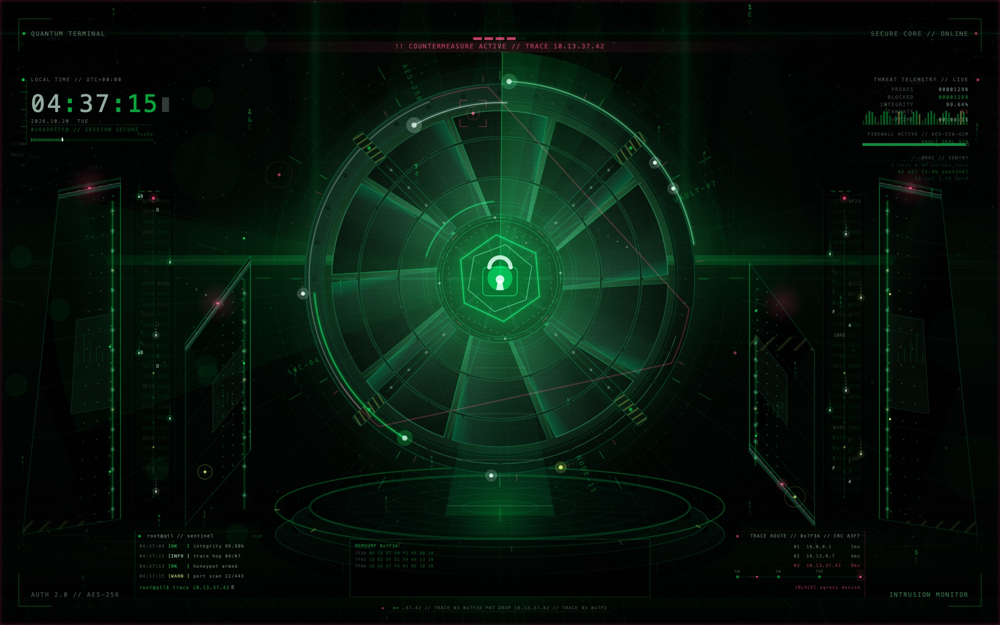

# Design

Quantum Terminal Live is an operations-console scene rather than a generic
"cyber" wallpaper. The visual language is a physical secure vault rendered in
layers, with the animation treated as telemetry rather than decoration.



## Concept

A machined iris vault floats above a reflective operations floor. A holographic
radar dome sweeps the space around it, a shield-and-lock core sits in the
aperture, and two server pylons frame the aisle. The frame is treated as a
secure operations station rather than a poster: a neon terminal clock and
threat-telemetry readout occupy the upper corners, a sentinel shell log and a
trace-route panel fill the lower corners, a DEFCON badge sits at top centre,
and a scrolling packet ticker runs along the bottom edge.

Falling code is confined to two recessed data curtains in the service aisles,
away from the vault, so it reads as infrastructure rather than a Matrix
overlay. The scene still avoids logos, watermarks and stock artwork. Text is
part of the interface: chrono, telemetry, shell log, trace hops, threat badge,
alert banner, ticker, engraved ring legends, background ledgers and four small
frame legends.

## Composition

| Layer | Description |
| --- | --- |
| Sky | Deep green-black gradient, star field, containment hexagons, bearing ticks, vertical depth beams. |
| Ceiling | Perspective seam fan and suspended light rails, giving the vault a room above it. |
| Data columns | Sparse hex/binary ledgers at the far left and right edges, screen-blended at very low alpha. |
| Aisle data walls | Recessed glyph curtains between the near and far pylons, with chassis rails, status ticks, red lamps and a shadow fade into the deck. |
| Vault | 10-blade iris, four radial locking bars, two machined cross-rings with rivets, outer housing, engraved sector legends, hazard-striped clamps, lit aperture. |
| Platform | Three-tier reflective plinth, radial spokes, front vent ribs, lit rim, amber hazard ticks, wet-floor streaks, light column. |
| Pylons | Two tall server monoliths with rack seams, LED matrices, holo panels, cap blocks, red strobe lenses, hazard bands, edge lighting and floor cables. |
| Floor | Printed-circuit traces, solder pads, inlaid containment hexagons, reflective rails, a neon horizon rail and a central light aisle. |
| Consoles | Lower-left sentinel shell log, lower-right trace-route panel, each on a recessed gradient with an accent rail. |
| Overlay | Radar dome, energy rings, shield/lock core, orbital traffic, pylon packets, particles, code rain, chrono, telemetry, threat badge, ticker, HUD, target lock. |
| Threat layer | Alert band, red edge wash, pylon strobes, vault warning arcs/ticks and a hostile core wash during the 1.7 s lockdown window. |
| Icon | The same iris, hex core and padlock rendered as a macOS squircle emblem. |

All dimensions are expressed as fractions of `min(width, height)`, so the same
code produces a 1920 × 1200 preview and the 7680 × 4800 master.

## Palette

| Role | Approx. hex | Use |
| --- | --- | --- |
| Void | `#010101` | Background, vignette, lock body |
| Deep green | `#030B06` | Sky, floor, fog |
| Steel | `#040B08` | Vault housing, platform, pylons |
| Edge green | `#008C4D` | Machined bevels, seams, circuitry |
| Neon green | `#00FF40` | Radar, energy rings, HUD, core, clock |
| Ice | `#CCFFE0` | Specular highlights, lock, digits, labels |
| Mint | `#52FF85` | Inner hex trace, secondary ring, holo panels |
| Alert red | `#FF2461` | Target lock, threat pings, alert segments |
| Amber | `#BFFF47` | Secondary contacts, traffic, hazard stripes |

Neon green is the sole environment hue; a lighter mint replaces the old violet
near the core and for pylon holograms; red is reserved for threat state and
appears in small quantities.

## Terminal clock

The upper-left module is a functional chrono, not a decoration:

- `HH:MM:SS` in Menlo with a two-pass neon stroke glow; the colons blink at 1 Hz.
- A block cursor after the seconds, blinking with the wall-clock fraction.
- Local date, weekday and UTC offset.
- A session hash derived from the current epoch.
- A 60-tick seconds rail with a bright head marker, so the seconds are legible
  even when the digits are small.

The live layer passes `Date()`, so the module shows the real local time. The
loop maker passes no date: it renders a fixed UTC reference advancing with the
loop. Geometry, palette and typography are identical in both modes.

The upper-right module shows deterministic threat telemetry — probe count,
blocked count, integrity percentage, a sparkline and a firewall legend. Every
term is a periodic function of the 30-second loop, so the movie stays seamless.

## Sentinel console

The lower-left console is a live shell fragment, not a static prop:

- A 15-entry log book of handshakes, probes, blocks, key rotations and integrity
  checks. Four lines are visible; the window advances one line every 2 seconds
  and wraps exactly once per loop.
- Timestamps are derived from the same chrono reading as the clock, offset by a
  few seconds per row, so the log always looks like it was just written.
- A shell prompt cycles through five short commands every 6 seconds, with a
  1 Hz block cursor.

The mirrored lower-right panel shows a fixed three-hop trace route, a blocked
egress status and a four-node chain with a probe travelling from gateway to
target every 2.5 seconds. The last node is red and bracketed.

## Threat state

Every 15 seconds the scene enters a 1.7-second lockdown:

- A red band replaces the DEFCON caption at top centre and alternates between
  `INTRUSION ATTEMPT` and `COUNTERMEASURE ACTIVE` copy on successive windows.
- The five-segment DEFCON badge flashes red; its normal state alternates between
  level 3 (elevated) and level 4 (severe) every 10 seconds.
- Three red arcs sweep the vault housing, 36 warning ticks rotate on the outer
  bearing ring, and a hostile wash tints the core.
- Pylon strobe lenses bloom and a red radial wash darkens the screen edges.

The vault's geometry never changes, so the alert reads as a state change rather
than a different scene.

## Code rain and ticker

Two glyph curtains stand in the service aisles between the near and far pylons.
Each wall has two columns; bright heads fall at one or two traversals per loop
with an upward-fading glyph trail. The rain is clipped to the wall recess and is
deliberately absent from the vault and the central aisle.

Behind everything, a faint Matrix-style digital rain fills the void in two
parallax layers: twenty-two far columns of green half-width katakana and hex
glyphs fall slowly and are brightened briefly by recent input, while six near
columns use a larger face and brighter, faster heads. Faint rays radiate from
the core, a corridor of perspective frames converges on it, twinkling motes and
two dust layers drift at different rates, and a few near-field bokeh discs —
which pulse brighter with keyboard/mouse activity — float in front of the vault.
A slow volumetric light sweep and a narrow searchlight blade each rotate once
per loop, a faint off-centre echo radar ring sits behind the main dome, violet
pulse rings expand from the core on every heartbeat, and a horizontal lens-flare
glare streams through it. Faint diagonal wall tracers cross the service aisle
mid-band. Together these give the vault a sense of infinite depth without
covering the HUD.

A 120-character packet ticker scrolls at 4 characters per second along the
bottom edge: 64 characters are visible at a time, so the text completes exactly
one cycle per 30-second loop. A red status lamp and a thin rule anchor it.

## Motion

Every animated term is an integer-period function of the 30-second loop, which
is why the movie can restart without a seam.

| Motion | Period |
| --- | --- |
| Camera breath / drift | 30 s |
| Radar sweep | 2 revolutions / 30 s |
| Energy ring A | 1 revolution / 30 s |
| Energy ring B | 2 revolutions, reverse |
| Energy ring C | 1 revolution, reverse |
| Core reticle / integrity arc / shield hex | 1 revolution (inner hex 2) |
| Authentication pulses | 6 s |
| Scan sweep | 7.5 s |
| Threat pings | 10 s |
| Orbital traffic | 1–3 revolutions, alternating direction |
| Pylon packets | 1–2 traversals |
| Clock colon blink | 1 s |
| Telemetry sparkline | 15 s |
| Sentinel log window | 2 s step, 30 s cycle |
| Shell prompt | 6 s per command |
| Trace probe | 2.5 s |
| Code rain | 1–2 traversals per column |
| Packet ticker | 4 chars/s, 120-char cycle |
| Threat alert | 15 s period, 1.7 s window |
| DEFCON level | 10 s |
| Title RGB-split glitch | 6 s (0.1 s pulse) |
| Threat reticle | 1 revolution |
| Matrix rain activity boost | 3 s decay after last input |
| Full-frame glitch | 15 s (0.12 s window) |
| Volumetric light sweep | 1 revolution / 30 s |
| Searchlight beam | 1 revolution / 30 s |
| Lens flare breath | 15 s |
| Core pulse rings | 6 s pulse (three ring phases) |
| Echo radar dash sweep | continuous dash phase |
| Wall tracers | 12 s traversal per streak |
| Memory-dump bytes | continuous count (256 steps / 30 s) |
| Process table refresh | 3 s |

The live app passes elapsed wall-clock time into the same periodic functions;
the loop maker passes `frameIndex / 30`. There is no separate animation code.

## Rendering pipeline

```
QuantumArtwork.generateBase(width:height:)
        │
        ├── Assets/quantum-terminal-live-wallpaper-8k.png
        │
QuantumScene.render(ctx,size:time:base:wallClock:)
        │
        ├── QuantumTerminalLive  (static master + geometry/text overlay layers, Date())
        └── QuantumLoopMaker     (900 frames → HEVC .mov, fixed UTC clock)

IconMaker.render(pixelSize:)
        │
        └── Assets/AppIcon.icns + Assets/AppIcon-1024.png
```

`QuantumArtwork` draws the static environment once, including the vignette.
The live app puts that master on a `CALayer` and draws the animated overlay in
two layers above it: a reduced-resolution geometry pass and a full Retina text
pass, so the HUD is crisp while the expensive vector work stays cheap.
`QuantumScene.render` skips the base when `base` is `nil`; the movie and preview
renderers still pass the master and produce a complete frame. Light uses
`.screen` blend, dark console panels use `.normal`. The geometry backing store
is capped at about 3.3 megapixels while the master and text stay at the
display's native backing resolution. The loop maker renders at full 7680 × 4800
at 30 fps.

## Icon

`Sources/IconMaker.swift` draws the emblem in a 1024-unit design space and
rasterises each iconset size natively, so the 16 pt and 32 pt variants stay
crisp. The emblem reuses the scene language: machined housing, 10-blade iris,
hex core, ice padlock, alert lamp and corner brackets. Mac OS-specific detail
(bolts, tick ring) is skipped below 64 px so the silhouette survives.

## Legibility on the desktop

The live window is placed at `CGWindowLevelForKey(.desktopWindow)`:

```
Window Server      -2147483626
Aerial wallpaper   -2147483625
Dock wallpaper     -2147483624
Quantum layer      -2147483623   ← here
Finder icons       -2147483603
```

It therefore sits above the wallpaper but below icons, and the window ignores
mouse events. A stronger vignette keeps the outer edges quiet for desktop icons;
the chrono and telemetry sit in the upper corners where the background is
darkest. The sentinel consoles sit in the dark gaps between the platform and the
near pylons, and the packet ticker runs below the platform shadow, so the centre
of the desktop stays clear for icons.

## Performance

The expensive work is drawing vector rings, gradients and text, not video
decoding. On an M5-class Mac at 1512 × 982 Retina:

- 20 fps overlay timer with 1 ms tolerance
- ~50–55% of one CPU core while fully visible on AC power
- ~250 MB resident memory
- Static master composited by the window server; geometry redrawn at ~3.3 MP, text at full Retina
- 10 fps on battery, 2 fps when fully covered or in Low Power Mode
- App Nap disabled with `ProcessInfo.beginActivity`
- display-sleep is the only full pause; a watchdog checks `CGDisplayIsAsleep`

Moving the master to its own layer removed a full-screen image resample and the
duplicate scene vignette from every frame. Splitting the overlay into geometry
and text passes keeps the HUD at native Retina sharpness while the radar, rings
and gradients stay at a bounded resolution. A faint CRT scanline is drawn as one
batched path so the raster effect costs a fraction of a millisecond, and the
alert frame uses thin filled bars because stroking a screen-sized rectangle made
CoreGraphics rasterise the whole bounding box. The 30 s movie still renders at
30 fps for smooth screen-saver playback.

The live app throttles its cadence from its watchdog: fully occluded windows,
battery power, and Low Power Mode each drop the frame rate so a hidden desktop
idles near zero CPU while the clock keeps advancing. A menu-bar status item
adds Pause/Resume, a neon intensity chooser (Vivid/Standard/Dim), an idle-dim
toggle, an Aerial shortcut, reveal-in-Finder and Quit. When idle dimming is on,
the desktop fades to 45% opacity after five minutes without input and restores
on the next keypress or mouse move, reducing OLED wear without pausing the
clock.

The scene draws many short monospaced runs: clock, telemetry, four log lines,
prompt, trace hops, badge, ticker and code rain. Rebuilding a `CTLine` for every
run on every frame is expensive, so `QuantumScene` caches lines and widths by
content, font size, kerning and colour. Per-frame telemetry counters are
excluded from the cache so it stays bounded.

The radar and ring geometry still dominate, but the console is the second
largest cost at Retina resolution. The 8K movie render is CPU-bound at roughly
0.8 seconds per frame.

The 8K movie is encoded at 22 Mbps average so the repository stays below
GitHub's 100 MiB per-file limit.
